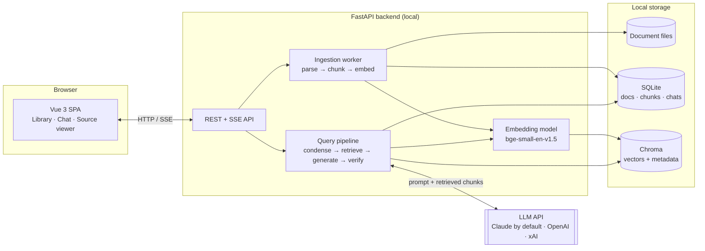
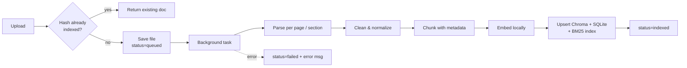
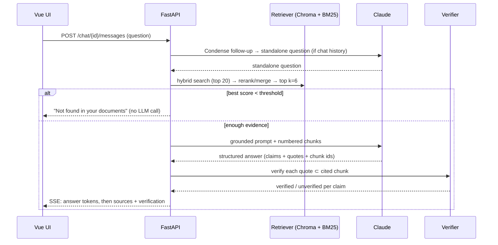
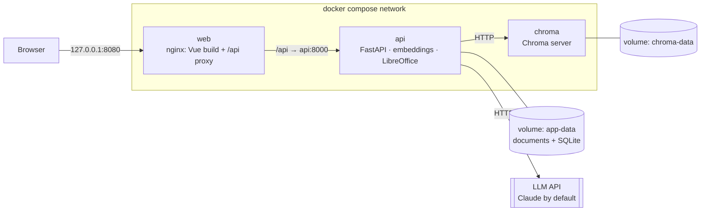

# Local LangChain Document Chatbot — System Design (v2)

| | |
|---|---|
| **Author** | Andy |
| **Date** | 2026-10-06 |
| **Status** | Draft v2.6 (LLM providers, see Appendix G) |
| **Stack** | Vue 3 · Python / FastAPI · LangChain · Claude (or OpenAI, xAI) · Chroma |

---

## 1. Purpose

A chatbot that runs on your own computer. You give it documents (PDF, DOC/DOCX, TXT), it shows you what's in them quickly, and it answers questions **only from those documents**. Every claim in an answer comes with a quote and a reference to where it came from.

### 1.1 Goals

- **Grounded answers.** Every answer is built only from retrieved document passages. If the documents don't contain the answer, the bot says so instead of guessing.
- **Checkable answers.** Every claim carries a verbatim quote plus the file and page or section. The backend checks those quotes before the answer is shown to you.
- **Fast understanding.** You can get a summary of each document and ask follow-up questions in a chat.
- **Runs on your machine.** The UI, API, vector DB, embeddings and document storage all run locally. Only the LLM call goes over the network (see §2.3).
- **Easy to share.** Clean repo on GitHub with no secrets or personal documents in it.

### 1.2 Non-goals (for the MVP)

- Multiple users, logins, or cloud hosting.
- Answering from general knowledge or the web.
- Documents that are mostly images, such as scanned PDFs (OCR is optional, see §5.2).

---

## 2. Requirements

### 2.1 Functional

| ID | Requirement |
|---|---|
| F1 | Upload PDF, DOCX, DOC and TXT files, one or several at a time |
| F2 | See each document's processing status (queued, processing, indexed, failed) |
| F3 | Ask questions across all documents or a chosen subset |
| F4 | Answers include citations (file, page or section, quoted text) you can click to view the source |
| F5 | Follow-up questions use earlier turns in the conversation |
| F6 | Generate a "what's in this document" summary on request |
| F7 | Delete a document, which also removes its vectors |
| F8 | When the answer isn't in the documents, show an explicit "not found in your documents" response |

### 2.2 Non-functional

| Area | Target |
|---|---|
| Groundedness | 100% of displayed claims pass quote verification, or are clearly marked unverified |
| Abstention | Questions whose answers aren't in the documents are refused, measured on the eval set (§12) |
| Latency | First streamed token in under 3 s on a typical laptop |
| Ingestion | A 100-page PDF is indexed in under 1 min (CPU embeddings) |
| Portability | Runs on Windows, macOS and Linux |
| Repo hygiene | No secrets, documents or DB files committed |
| Secret protection | No API key or other secret ever reaches the Git history or GitHub. Enforced by a pre-commit hook, a CI scan and GitHub push protection (§13.1) |
| Dependency security | Zero known **High or Critical** vulnerabilities (CVSS ≥ 7.0) in Python packages, npm packages and container images that ship. Enforced in CI, which fails the build (§13.2) |

### 2.3 Data boundary: what stays local and what leaves

This is important for privacy, so it's spelled out here.

| Component | Where it runs | Data that leaves the machine |
|---|---|---|
| Vue frontend | Local (browser) | None |
| FastAPI backend | Local | None |
| Document files + SQLite metadata | Local disk | None |
| Embeddings (sentence-transformers) | Local CPU/GPU | None (model weights downloaded once) |
| Chroma vector DB | Local disk | None |
| **LLM** (`LLM_PROVIDER`) | **Provider's API (cloud): Anthropic by default, or OpenAI / xAI.** | **To the cloud provider: your question, recent chat turns (the last `HISTORY_TURNS` question/answer pairs plus a short summary of older ones, only for follow-ups, §6.1 step 1), and the retrieved chunks.** Document summaries (F6) send every chunk of that document. Pipeline mode: the top 6. Agent mode (`QA_MODE=agent`, §6.2): every chunk the agent's searches and reads return (often 10–25 per question), plus the document filenames and ids if it calls `list_documents` |

> Agent mode sends more of your documents per question than pipeline mode: each search returns up to `AGENT_SEARCH_K_MAX` chunks, and the agent may search up to `AGENT_MAX_TOOL_CALLS` times. Traces of what was searched and read stay in the local SQLite DB (`qa_traces`, `qa_trace_steps`); stdout logs carry only ids, counts and timings.

> The system is **local-first, not offline**. Only the selected provider receives the data above; the other providers' keys are never used. Local-only operation (no LLM call) is out of scope: the design assumes a cloud LLM provider.

---

## 3. Architecture

### 3.1 Component view



### 3.2 Design principles

1. **Retrieval is the only source of truth.** The LLM never answers without retrieved context, and the prompt forbids using outside knowledge.
2. **Trust, but verify.** The LLM's output is checked by plain code (quote matching) before it's shown.
3. **Prefer refusing over guessing.** If retrieval is weak, refuse before calling the LLM at all.
4. **Swappable parts.** The embedder, vector store and LLM each sit behind a small interface, so Chroma → Qdrant or Claude → GPT / Grok is a config change (`LLM_PROVIDER`, §4.3).
5. **Single user, single process.** No queues or brokers for the MVP. FastAPI background tasks are enough.

---

## 4. Tech stack

### 4.1 Frontend

| Concern | Choice |
|---|---|
| Framework | Vue 3 + Vite + TypeScript |
| State | Pinia |
| UI kit | PrimeVue |
| HTTP | Axios (REST), native `EventSource`/`fetch` stream (SSE) |
| PDF viewing | `vue-pdf-embed` (pdf.js) to jump to the cited page |
| Markdown in answers | `markdown-it` (sanitized) |

### 4.2 Backend

| Concern | Choice | Notes |
|---|---|---|
| Runtime | Python 3.11+ | |
| API | FastAPI + Uvicorn | async, OpenAPI docs at `/docs` |
| Orchestration | LangChain (`langchain`, `langchain-anthropic`, `langchain-openai`, `langchain-xai`, `langchain-chroma`, `langchain-huggingface`, `langchain-community`) | |
| LLM | Claude via `ChatAnthropic` (default); `ChatOpenAI` or `ChatXAI` by `LLM_PROVIDER` | model ID set via `LLM_MODEL` (`CLAUDE_MODEL` still read when it is empty); pin a specific version |
| Embeddings | `BAAI/bge-small-en-v1.5` via `HuggingFaceEmbeddings` | local, 384-dim, CPU-friendly. Use `BAAI/bge-m3` for non-English or mixed-language documents |
| Vector DB | Chroma (persistent client, cosine space) | |
| Keyword search | Own BM25 over the SQLite chunk text (`retrieval/keyword.py`) | used for hybrid retrieval; replaces `rank_bm25` / `BM25Retriever` (Appendix F) |
| Metadata DB | SQLite via SQLModel | |
| PDF parsing | `pypdf` (PyPDF2 is deprecated); `pdfplumber` fallback for complex layouts | |
| DOCX parsing | `python-docx` | |
| DOC parsing | LibreOffice headless converts `.doc` → `.docx`, then `python-docx` | needs LibreOffice installed |
| Quote matching | `rapidfuzz` | tolerant to whitespace and hyphenation differences |
| Testing | `pytest`, `httpx` | |

> **Note on embeddings:** Anthropic does **not** provide an embeddings API. Decision: use **free, open-source embeddings run locally** with sentence-transformers. There's no API key and no cost, and document text never leaves your machine. If retrieval quality is too low, try another free model first (`bge-base-en-v1.5`, `bge-m3`) or turn on the free cross-encoder reranker (`bge-reranker-base`) before considering anything paid.

### 4.3 Internal interfaces

```python
class Embedder(Protocol):
    def embed_documents(self, texts: list[str]) -> list[list[float]]: ...
    def embed_query(self, text: str) -> list[float]: ...

class ChatModel(Protocol):          # generation/llm.py; any LangChain chat model behind it
    def invoke_structured(self, messages, schema: type[T]) -> StructuredReply[T]: ...
    def invoke_with_tools(self, messages, tools: list[dict]) -> AIMessage: ...    # agent mode
    def stream_structured(self, messages, schema: type[T]) -> Iterator[str | StructuredReply[T]]: ...
```

`build_llm(settings)` picks the LangChain class from `LLM_PROVIDER` and imports its package only then:

| `LLM_PROVIDER` | Class | Key | Default cost rates |
|---|---|---|---|
| `anthropic` (default) | `ChatAnthropic` | `ANTHROPIC_API_KEY` | Haiku 5.5: $0.10 / $0.50 per MTok |
| `openai` | `ChatOpenAI` (`stream_usage=True`) | `OPENAI_API_KEY` | none: must be set while `DAILY_BUDGET_USD` > 0 |
| `xai` | `ChatXAI` (`stream_usage=True`) | `XAI_API_KEY` | none: must be set while `DAILY_BUDGET_USD` > 0 |

- All four use the same calls: `with_structured_output(schema, method="json_schema")` (answers, condensing, summaries), its bound model streamed for SSE, and `bind_tools(..., tool_choice="auto")` with the Anthropic-format tool specs, which LangChain converts. 
- Token usage comes from LangChain's `usage_metadata`, the same for every provider.
- Stop reasons are normalised for the agent loop (`llm.stop_reason`): OpenAI/xAI `finish_reason` `"stop"` → `"end_turn"`.
- Any exception from any provider becomes `LLMUnavailable` → `llm_unavailable` 503 (§9). A missing key or model raises `LLMNotConfigured` naming what to set.
- No default prices for OpenAI / xAI on purpose: a guessed rate would make the daily budget wrong, so startup fails until both rates are set (or the budget is off).

---

## 5. Ingestion pipeline



### 5.1 Steps

1. **Upload & validate.** Check the extension and MIME type, and enforce a size limit (default 50 MB). Compute a SHA-256 of the file and skip it if that hash is already indexed (no duplicate vectors).
2. **Store.** Save to `data/documents/{doc_id}{ext}` and insert a `documents` row with `status=queued`. Return immediately.
3. **Parse** (background task), keeping location information:
   - PDF: text per page → `page` metadata.
   - DOCX: paragraphs grouped under their nearest heading → `section` metadata.
   - DOC: convert with `soffice --headless --convert-to docx`, then handle as DOCX. Each conversion runs in a temp dir with its own LibreOffice profile (`-env:UserInstallation`; two soffice processes on one profile block each other), with a `DOC_CONVERT_TIMEOUT_S` limit (default 120 s). soffice can exit 0 without writing anything, so a missing `.docx` counts as a failure. LibreOffice missing → the document is `failed` with a clear message.
   - TXT: read as UTF-8 (fall back to `charset-normalizer`), split by blank-line blocks.
   - HTML (`.htm`, `.html`): visible text grouped under its nearest heading → `section` metadata, like DOCX. Headings are `<h1>`–`<h6>` and short all-bold lines (`<b>`, `<strong>`, `font-weight` ≥ 600), because SEC filings and most exported HTML mark headings only with bold. Tables become one `a | b` line per row; `script`, `style`, `head` and hidden elements (`display:none`, `hidden`) are dropped; the SEC EDGAR envelope (`<DOCUMENT><TYPE>…<TEXT>`) is stripped. A heading with no text before the next one stays in the text, so a misdetected heading loses nothing. The original is only ever served as a download (`attachment` + `nosniff`), never rendered.
4. **Clean.** Normalize whitespace, rejoin words hyphenated across lines, remove repeated headers and footers.
5. **Chunk.** `RecursiveCharacterTextSplitter`, **1,000 chars / 150 overlap** as a starting point (tune with the eval set). Chunks never cross page boundaries, so citations stay exact. Alternative `CHUNK_STRATEGY=paragraph`: whole paragraphs, under `MIN_CHUNK_CHARS` merged with the next, over `MAX_CHUNK_CHARS` split between sentences. Paragraphs are found per format: PDF lines are wrapped (a short line ending a sentence, or a bullet on the next line, ends a paragraph), DOCX/HTML lines are paragraphs with table rows kept together, TXT is guessed from its line lengths. A chunk is always a verbatim slice of the cleaned page/section text. No chunk may exceed 2,000 chars (what `bge-small` reads); settings are checked at startup. Each document stores its chunking (`documents.chunking`), and `rebuild-index --rechunk` re-chunks and re-embeds the ones that differ. Eval (2026-10-27, retrieval-only, all docs, 41 answerable, hybrid): fixed hit@6 **98%**, paragraph 800–1200 93%, paragraph 200–1200 88% (`bsb.txt` 4,978 / 4,847 / 15,203 chunks). Paragraph mode finds fees-07 (the next-chunk case) but its smaller chunks rank lower, so `fixed` stays the default.
6. **Embed** locally in batches.
7. **Index.** Add to Chroma (`id = {doc_id}:{chunk_index}`) with metadata, mirror the chunk text in SQLite. The in-memory BM25 index is rebuilt from SQLite on the next search, because the set of indexed documents changed.
8. **Mark** `status=indexed`, or `failed` with an error message.
9. **Summarize (on request, not at ingestion).** `POST /documents/{id}/summary` runs a background job on its own queue: map over batches of `SUMMARY_BATCH_CHARS` of chunk text (each batch → up to 8 points, each with a verbatim quote, verified like answer claims; unverified points are dropped), then reduce (a 2–4 sentence overview written from the verified points only, plus the ≤ 10 points that best cover the document). Stored in `documents.summary` / `summary_points`. The cost is estimated from the text length first and the request is refused if it would exceed what is left of the daily budget; the tokens are recorded in `llm_usage`. Not at ingestion because a large document costs real money (the 4 MB `bsb.txt` is about $0.15 on Haiku).

### 5.2 Edge cases

| Case | Handling |
|---|---|
| Scanned or image-only PDF | Detect pages with almost no text and mark the doc `needs_ocr`. Optional: OCR with Tesseract (`pytesseract`) in a later phase |
| Password-protected PDF | Fail with a clear message |
| Very large file | Process page by page, report progress (`chunks_done/chunks_total`) |
| Re-upload of an edited file | New hash creates a new document; the user can delete the old one |

---

## 6. Query pipeline



### 6.1 Steps

1. **Condense the question.** If there are earlier turns, ask Claude to rewrite the question so it stands on its own ("what about the second one?" becomes "what are the risks of option B?"). Only the last `HISTORY_TURNS` (6) question/answer pairs are sent, each answer cut to `HISTORY_ANSWER_CHARS`; failed questions are left out. When there are more, the oldest are folded into a running summary (`conversations.summary`, one extra call every few questions, ≤ 150 words) that is sent instead. Everything after this step uses only the standalone question, so the answer is still built from excerpts alone; it is saved on the user message (`standalone_question`) and shown under it. Both modes condense the same way: the agent gets the standalone question.
2. **Hybrid retrieval** (`RETRIEVAL_MODE=hybrid`). Vector search (Chroma, cosine) and BM25 keyword search each return `HYBRID_CANDIDATES` (20) chunks from the searchable documents, merged by reciprocal-rank fusion (`w / (60 + rank)` per list, the method `EnsembleRetriever` uses) with equal weights (`BM25_WEIGHT=0.5`), top `k=6` kept. Keyword search catches exact names, IDs and numbers that embeddings miss; the tokenizer keeps compounds such as `1:1`, `5.00` or `INV-4471` whole as well as in parts, and drops question words. Every result carries its cosine similarity to the question, also when only keyword search found it, so the gate and the agent's scores mean the same thing in both modes. `RETRIEVAL_MODE=vector` turns keyword search off (for comparison). Optional reranking (`RERANK=true`, off by default): a local cross-encoder (`RERANK_MODEL`, `bge-reranker-base`) reorders the best `RERANK_CANDIDATES` (20) results and the top `k` are kept; the cosine score stays the relevance-gate score (cross-encoder scores are on another scale), and traces record each chunk's `rerank_score` and `search_rank`. Eval (2026-10-27, retrieval-only, all docs, 41 answerable): hybrid hit@6 98% → 93% with `bge-reranker-base` (rank-1 hits 26 → 32, MRR 0.76 → 0.84, but two follow-ups as typed fell out of the top 6) and 90% with `ms-marco-MiniLM-L-6-v2`; `bge-reranker-base` costs 5–7 s per search on CPU, so it stays off.
3. **Relevance gate.** If the best vector similarity among the results (not necessarily the first: results are in fused order) is below `MIN_RELEVANCE` (default 0.35, tune on the eval set), return a "not found" response **without calling the LLM**.
4. **Build context.** Up to `k=6` chunks, each labelled `[C1]…[C6]` with file name and page or section, kept to a token budget.
5. **Generate.** Claude with `temperature=0`, the grounded system prompt (§7.2), and structured output (`with_structured_output(GroundedAnswer)`).
6. **Verify** (§7.3).
7. **Respond.** Stream the answer text over SSE, then send a final `sources` event with verification results. The UI shows a "verified" badge per claim, or marks a claim as unverified. The answer is generated as structured JSON; the `answer` field is read out of the partial JSON as it arrives and sent as `token` events.

> **Trade-off:** streaming shows text before verification finishes. The streamed text is shown greyed out, and the `sources` event carries the final answer, which replaces it (entirely, with a warning, when the answer is withheld). A `STRICT_MODE=true` setting turns token streaming off and shows only answers that are fully verified (status events are still sent).

### 6.2 Agent mode (`QA_MODE=agent`)

Instead of one search with the question as the query, Claude gets read-only tools and decides what to search. Full design: [agentic_ai.md](agentic_ai.md). Code: `generation/agent.py`, `generation/tools.py`.

```
question ──► loop (≤ AGENT_MAX_TOOL_CALLS):  Claude ──tool call──► search_documents / read_chunk / list_documents
                                               ▲                         │ labelled excerpts [C#] + scores
                                               └─────────────────────────┘
          ──► hard stop if no search scored ≥ MIN_RELEVANCE ──► grounded prompt over every excerpt seen
          ──► GroundedAnswer (structured) ──► verify quotes against every excerpt seen ──► reply + steps
```

1. **Tools** (all read-only, all limited to the conversation's document filter whatever ids the model passes): `search_documents(query, doc_ids?, k)`, `read_chunk(doc_id, idx, before, after)` for neighbouring chunks, `list_documents()`.
2. **Labels.** Every chunk the agent sees gets one `C#` label for the whole question; a repeat keeps its label and isn't resent.
3. **Limits.** `AGENT_MAX_TOOL_CALLS` (5), `AGENT_TIMEOUT_S` (45), `AGENT_TOKEN_CAP` (30k in + out). On a limit the loop stops and answers from what it found. `tool_choice` is never forced.
4. **Final answer.** The same grounded prompt (§7.2) and `GroundedAnswer` schema as the pipeline, over every excerpt collected, so verification (§7.3) and `STRICT_MODE` are unchanged.
5. **Steps.** Each tool call (query, documents, result labels and scores, no document text) and each model note is saved to `qa_trace_steps` and returned with the reply as `steps` (§9). Over SSE each tool call is also sent as a `status` event when it finishes, so the UI shows the searches live.

Pipeline mode stays the default and the fallback. Both modes are compared on the eval set (§12, results in Appendix D).

---

## 7. Anti-hallucination design

RAG alone **reduces** hallucination but doesn't remove it: the model can still misparaphrase, combine passages wrongly, or fill in gaps. This design uses five layers, and each one catches what the previous one misses.

| # | Layer | Type | What it catches |
|---|---|---|---|
| 1 | Relevance gate (§6.1 step 3). Agent mode: similarity scores in every tool result, plus a hard stop when no search scored ≥ `MIN_RELEVANCE` (§6.2) | Code | Questions the documents can't answer, refused before the answer call |
| 2 | Grounded prompt + quote-first format. Agent mode: the excerpts-are-data rule is in the agent system prompt and in every tool result | Prompt | The model drifting into outside knowledge; instructions hidden in documents |
| 3 | Structured output schema | Schema | Free-form answers without traceable sources |
| 4 | Quote verification | Code | Made-up or altered quotes, and wrong chunk IDs |
| 5 | Evaluation set in CI (§12) | Process | Regressions when prompts, chunking or models change |

### 7.1 Output schema

```python
class Claim(BaseModel):
    statement: str              # one factual sentence
    quote: str                  # verbatim text copied from the chunk
    chunk_id: str               # e.g. "C3"

class GroundedAnswer(BaseModel):
    answerable: bool            # False → "not in your documents"
    answer: str                 # short prose answer built only from claims
    claims: list[Claim]
```

### 7.2 System prompt (core)

```text
You answer questions using ONLY the numbered document excerpts provided.

Rules:
1. Before answering, find the exact sentences in the excerpts that support the answer.
2. Every factual statement must have a verbatim quote and the excerpt id it came from.
3. Copy quotes exactly. Do not paraphrase inside a quote.
4. If the excerpts do not contain the answer, set answerable=false. Do not guess.
5. Do not use outside knowledge, even if you know the answer.
6. If excerpts conflict, say so and cite both.

<excerpts>
[C1] (report.pdf, p. 4) ...
[C2] (contract.docx, §3.2 Termination) ...
</excerpts>
```

### 7.3 Quote verification

For each claim:

1. Normalize the quote and the cited chunk (case, whitespace, hyphenation, curly quotes).
2. **Pass** if the quote is an exact substring. Otherwise use `rapidfuzz.fuzz.partial_ratio ≥ 90`.
3. If it fails against the cited chunk, check the other retrieved chunks (agent mode: every chunk the agent saw). If it's found elsewhere, fix the `chunk_id`.
4. If it's still not found, mark the claim **unverified**.

Answer-level outcome:

| Result | Behaviour |
|---|---|
| All claims verified | Show answer with ✓ badges |
| Some unverified | Show answer, highlight the unverified claims, offer "show only verified" |
| None verified | Replace with "I couldn't find support for an answer in your documents" |

`groundedness = verified_claims / total_claims` is stored with each message. It replaces the meaningless "confidence" field from v1.

---

## 8. Data model

### 8.1 SQLite

```text
documents
  id TEXT PK            -- uuid
  filename TEXT
  ext TEXT
  sha256 TEXT UNIQUE
  size_bytes INTEGER
  status TEXT           -- queued | processing | indexed | failed | needs_ocr
  error TEXT NULL
  page_count INTEGER NULL
  chunk_count INTEGER
  summary TEXT NULL     -- overview, written from summary_points
  summary_points JSON NULL  -- verified points: statement, quote, chunk, page/section
  summary_status TEXT NULL  -- queued | running | done | failed
  summary_error TEXT NULL
  created_at DATETIME

chunks
  id TEXT PK            -- "{doc_id}:{index}"
  document_id TEXT FK → documents.id ON DELETE CASCADE
  idx INTEGER
  text TEXT
  page INTEGER NULL
  section TEXT NULL
  char_start INTEGER
  char_end INTEGER

conversations
  id TEXT PK
  title TEXT
  doc_filter JSON NULL  -- optional list of doc ids
  summary TEXT NULL     -- running summary of exchanges older than the history window
  summary_through TEXT NULL  -- id of the last message folded into it
  created_at DATETIME

messages
  id TEXT PK
  conversation_id TEXT FK
  role TEXT             -- user | assistant
  content TEXT
  standalone_question TEXT NULL
  sources JSON NULL     -- [{chunk_id, doc_id, page, quote, verified}]
  groundedness REAL NULL
  created_at DATETIME

llm_usage               -- LLM calls outside a question (document summaries), for the budget
  id TEXT PK
  kind TEXT             -- document_summary
  document_id TEXT NULL -- no FK: the cost stays after the document is deleted
  input_tokens, output_tokens INTEGER
  cost_usd REAL
  provider TEXT NULL    -- LLM_PROVIDER / LLM_MODEL of the calls (NULL on rows from before v2.6)
  model TEXT NULL
  created_at DATETIME
```

`qa_traces` / `qa_trace_steps` (agent redesign, Appendix D) also store `standalone_question` and token usage per call stage (`condense`, `summary`, `loop`, `answer`); the trace `settings` JSON and the `qa` log line carry `provider` and `model`.

### 8.2 Chroma collection `documents`

- `id`: `{doc_id}:{idx}`
- `embedding`: 384-dim (bge-small)
- `document`: chunk text
- `metadata`: `{doc_id, filename, page, section, idx}`
- Collection metadata: `{"hnsw:space": "cosine", "embedding_model": "bge-small-en-v1.5"}`. Changing the embedding model requires re-indexing, and the backend refuses to start if they don't match.

---

## 9. API

Base URL `http://localhost:8000/api`. All JSON except upload (multipart) and chat (SSE).

| Method | Path | Purpose |
|---|---|---|
| `POST` | `/documents` | Upload one or more files → `[{id, filename, status}]` |
| `GET` | `/documents` | List documents with status and counts |
| `GET` | `/documents/{id}` | Status, progress, error, summary status |
| `GET` | `/documents/{id}/summary` | Summary, verified points, job status, estimated cost of (re)generating it |
| `GET` | `/documents/{id}/file` | Original file (for the source viewer) |
| `GET` | `/documents/{id}/chunks/{idx}` | A single chunk with page and section |
| `POST` | `/documents/{id}/summary` | (Re)generate summary in the background (202). 409 not indexed / already running, 429 over budget, 503 no model |
| `DELETE` | `/documents/{id}` | Delete file, SQLite rows **and** Chroma vectors; the BM25 index drops it on the next search |
| `POST` | `/conversations` | Create conversation `{title?, doc_filter?}` |
| `GET` | `/conversations` | List conversations, newest first |
| `GET` | `/conversations/{id}` | Conversation with messages; agent-mode answers include their `steps` |
| `PATCH` | `/conversations/{id}` | Rename `{title}` |
| `DELETE` | `/conversations/{id}` | Delete with its messages and traces |
| `POST` | `/conversations/{id}/messages` | Ask a question. With `Accept: text/event-stream`: SSE stream (§9.1, the UI uses this); otherwise a JSON reply `{message_id, outcome, answer, groundedness, claims, retrieval, steps, standalone_question}` (tests, eval) |
| `GET` | `/conversations/{id}/traces` | How each answer was produced, with agent steps (local debugging) |
| `GET` | `/usage?days=7` | Tokens and estimated cost per UTC day, today's budget and what's left |
| `GET` | `/health` | Model and DB check, embedding-model match |

### 9.1 Chat SSE events

```text
event: status   data: {"stage": "condensing"}                      # follow-ups only
event: status   data: {"stage": "condensed", "question": "What is the fee for a PLUS System ATM withdrawal outside North America?"}
event: status   data: {"stage": "retrieving"}                      # agent mode: "searching"
# agent mode: one status event per tool call, same fields as a reply's `steps` entry
event: status   data: {"stage": "tool_call", "kind": "tool_call", "tool": "search_documents",
                       "input": {"query": "night deposit bag fee", "doc_ids": ["services_fees.pdf"]},
                       "output": [{"label": "C7", "filename": "services_fees.pdf", "page": 6, "score": 0.76, "new": true}]}
event: status   data: {"stage": "answering"}
event: token    data: {"text": "The contract can be terminated "}   # not in STRICT_MODE
event: token    data: {"text": "with 30 days' notice [C2]."}
event: status   data: {"stage": "verifying"}
event: sources  data: {"message_id": "…", "outcome": "verified", "answerable": true,
                       "answer": "The contract can be terminated with 30 days' notice [C2].",
                       "groundedness": 1.0, "claims": [{"statement": "…", "quote": "…", "label": "C2",
                       "verified": true, "chunk_id": "…", "doc_id": "…", "filename": "contract.docx",
                       "section": "3.2 Termination", "page": null}],
                       "retrieval": {"top_score": 0.71, "k": 6}, "steps": [], "standalone_question": null}
event: done     data: {"message_id": "…"}
```

`sources` carries the same fields as the JSON reply; its `answer` replaces the streamed text. Errors are sent as `event: error` with `{code, message}` (`no_documents`, `budget_exceeded`, `llm_unavailable`, `internal_error`). An unknown conversation or an invalid body is still a plain HTTP 404 / 422 before the stream starts. The answer runs on a worker thread: if the client disconnects, it still finishes and is saved.

---

## 10. Frontend

| View / component | Responsibility |
|---|---|
| `DocumentLibrary` | Upload drop zone, list with live status (polls `GET /documents/{id}` while processing), delete, summary dialog (`SummaryDialog`: overview + verified points with quotes, generate/regenerate with the estimated cost, polls while running) |
| `ChatView` | Conversation list, message thread, document filter chips. Reads the SSE stream: live status line, streamed text (greyed until verified), "Searched for: …" under a condensed follow-up |
| `AnswerMessage` | Renders answer markdown, inline `[C#]` markers, ✓ / ⚠ badges per claim. Agent mode: a collapsible list of the agent's steps ("Searched … : 6 results, best 0.82", "Read fees.pdf, p. 4", its notes) |
| `SourcePanel` | Side panel: clicking a citation opens the PDF at the cited page with the quote highlighted, or shows the DOCX/TXT chunk |
| `SettingsDialog` | Strict mode toggle, top-k, document filter defaults |

UX rules: never display an answer without its sources, always show a clear "not found in your documents" state, and show ingestion progress.

---

## 11. Project structure & configuration

```text
langchain-chatbot/
├── backend/
│   ├── app/
│   │   ├── main.py              # FastAPI app, CORS (localhost only)
│   │   ├── config.py            # pydantic-settings, reads .env
│   │   ├── api/                 # documents.py, conversations.py, health.py
│   │   ├── ingestion/           # parsers/, chunker.py, pipeline.py
│   │   ├── retrieval/           # embedder.py, vectorstore.py, hybrid.py
│   │   ├── generation/          # prompts.py, schemas.py, chain.py
│   │   ├── verification/        # quotes.py
│   │   └── db/                  # models.py, session.py
│   ├── tests/
│   │   ├── unit/
│   │   └── eval/                # eval_set.yaml + run_eval.py
│   ├── requirements.txt
│   ├── Dockerfile
│   └── .dockerignore
├── frontend/
│   ├── src/ (components/, views/, stores/, api/)
│   ├── package.json
│   ├── nginx.conf
│   ├── Dockerfile
│   └── .dockerignore
├── .github/
│   ├── workflows/ci.yml         # secret scan → vuln scan → test → eval smoke → build, scan & push images (GHCR)
│   └── dependabot.yml           # weekly pip / npm / Docker / Actions updates
├── .pre-commit-config.yaml      # gitleaks secret scan before every commit
├── .gitleaks.toml               # secret-scan rules (adds Anthropic, OpenAI and xAI key patterns)
├── docker-compose.yml
├── .env.example
├── data/                        # git-ignored; native dev only (Docker uses volumes)
├── .gitignore
├── README.md
└── LICENSE
```

The backend also gets `app/storage/` (local / S3 adapters) and `app/jobs/` (in-process / Redis adapters) for the cloud switches in §15.

### 11.1 `.env.example`

```ini
LLM_PROVIDER=anthropic   # anthropic | openai | xai (§4.3)
LLM_MODEL=               # pin a specific model ID; CLAUDE_MODEL still works
ANTHROPIC_API_KEY=       # only the selected provider's key is needed
OPENAI_API_KEY=
XAI_API_KEY=
EMBEDDING_MODEL=BAAI/bge-small-en-v1.5

# Infrastructure switches (docker-compose.yml overrides these for Docker)
CHROMA_MODE=embedded     # embedded (native dev) | http (Docker / cloud)
CHROMA_HOST=localhost
CHROMA_PORT=8000
CHROMA_PATH=./data/chroma           # embedded mode only
DATABASE_URL=sqlite:///./data/app.db  # cloud: postgresql://...
STORAGE_BACKEND=local    # local | s3
STORAGE_DIR=./data/documents
JOB_BACKEND=inprocess    # inprocess | redis
KEYWORD_BACKEND=memory   # memory | postgres

# Tuning
CHUNK_STRATEGY=fixed     # fixed | paragraph (§5.1 step 5)
CHUNK_SIZE=1000          # ≤ 2000: bge-small reads ~512 tokens
CHUNK_OVERLAP=150
MIN_CHUNK_CHARS=200      # paragraph mode: shorter paragraphs merge with the next
MAX_CHUNK_CHARS=1200     # paragraph mode: longer ones split between sentences; MAX + MIN ≤ 2000
TOP_K=6
MIN_RELEVANCE=0.35
RETRIEVAL_MODE=hybrid    # hybrid (vector + BM25, §6.1 step 2) | vector
BM25_WEIGHT=0.5          # vector gets 1 - this
HYBRID_CANDIDATES=20     # from each search, before fusion
RERANK=false             # local cross-encoder over the best RERANK_CANDIDATES (§6.1 step 2)
RERANK_MODEL=BAAI/bge-reranker-base
RERANK_CANDIDATES=20
STRICT_MODE=false
MAX_UPLOAD_MB=50
SOFFICE_PATH=soffice     # LibreOffice for .doc → .docx (§5.1 step 3)
DOC_CONVERT_TIMEOUT_S=120

# Q&A mode: pipeline (one search, one LLM call) | agent (the LLM searches with tools, §6.2)
QA_MODE=pipeline
AGENT_MAX_TOOL_CALLS=5
AGENT_TIMEOUT_S=45
AGENT_TOKEN_CAP=30000
AGENT_SEARCH_K_MAX=10
AGENT_READ_NEIGHBORS_MAX=2

# Cost estimate and daily budget (§9 /usage); 0 = no budget. Rates unset: Haiku 5.5 for
# anthropic; openai / xai must set both while the budget is on (§4.3)
# LLM_INPUT_USD_PER_MTOK=0.10
# LLM_OUTPUT_USD_PER_MTOK=0.50
DAILY_BUDGET_USD=1.00

# Follow-ups (§6.1 step 1) and document summaries (§5.1 step 9)
HISTORY_TURNS=6
HISTORY_ANSWER_CHARS=800
SUMMARY_BATCH_CHARS=100000
SUMMARY_WORKERS=4
```

### 11.2 `.gitignore` (essentials)

```gitignore
.env
data/
*.db
chroma/
__pycache__/
.venv/
node_modules/
dist/
```

### 11.3 `.dockerignore` (backend and frontend)

Keeps secrets, data and local environments out of images and speeds up builds.

```gitignore
.env
data/
.venv/
node_modules/
dist/
__pycache__/
tests/eval/output/
.git/
```

---

## 12. Evaluation & testing

Groundedness is a requirement, so it's tested from the start, not left to the end.

### 12.1 Eval set (`eval/eval_set.yaml`)

The runner (`eval/run_eval.py`) and a template are committed; the set and its documents are git-ignored because they're the user's own (see `eval/README.md`). Use 2–3 documents and about 30 questions:

- **Answerable** (about 20): expected answer plus the page or chunk that must be retrieved.
- **Unanswerable** (about 10): plausible questions whose answers are *not* in the documents. The bot must refuse.
- **Follow-ups** (M4, about 10): a question that only makes sense after earlier turns, which are given as `history` (question + answer). Include answerable and unanswerable ones, a two-turn history and a topic switch.

### 12.2 Metrics (`run_eval.py`)

| Metric | Target (MVP) |
|---|---|
| Retrieval hit@6 (correct chunk retrieved) | ≥ 90% |
| Quote verification pass rate | ≥ 95% of claims |
| Correct refusal on unanswerable | ≥ 90% |
| False refusal on answerable | ≤ 10% |
| Follow-ups answered correctly (answered with every quote verified and every expected keyword, or refused when unanswerable) | ≥ 90% |

The runner also reports expected keywords, whether the evidence was in any chunk the answer saw, tokens and estimated cost, latency, and in agent mode tool calls and stop reasons. `--mode pipeline|agent` and `--scope all|doc` (all documents, like the chat, or only the question's own document).

Run it whenever prompts, chunking, retrieval settings or the model change. Unit tests cover parsers, chunk page mapping, quote normalization, and delete cascading to Chroma.

---

## 13. Security & privacy

### 13.1 Secrets: the API key never reaches GitHub

**Requirement:** the LLM API keys (`ANTHROPIC_API_KEY`, `OPENAI_API_KEY`, `XAI_API_KEY`) and any future secret (DB passwords, S3 keys) must never be committed, pushed, baked into an image, logged or returned by the API.

Defence in depth: each layer catches what the one before it misses.

| # | Layer | Where | What it does |
|---|---|---|---|
| 1 | `.gitignore` | Repo | `.env` is ignored. Only `.env.example` (blank values) is committed |
| 2 | Pre-commit hook | Developer machine | `gitleaks` (via `pre-commit`) scans staged changes and **blocks the commit** if a key is found. `.gitleaks.toml` adds rules for Anthropic (`sk-ant-…`), OpenAI (`sk-…`, `sk-proj-…`) and xAI (`xai-…`) keys, with no entropy check so fake test keys are caught too |
| 3 | CI secret scan | GitHub Actions | `gitleaks` scans the full history on every push and PR. The build fails on any finding |
| 4 | GitHub secret scanning + **push protection** | GitHub repo settings | GitHub rejects a push that contains a recognised key, before it's stored |
| 5 | Runtime handling | Backend | Keys loaded as `pydantic.SecretStr`; only the selected provider's key is passed to its client, so it prints as `**********`. It is never logged and never returned by `/api/health` or errors |
| 6 | Images | Docker | `.env` is in `.dockerignore`. Secrets are passed at runtime (`env_file`), never with `ARG`/`ENV` in a Dockerfile |
| 7 | CI secrets | GitHub Actions | Any key CI needs (e.g. the eval smoke test) is a GitHub Actions **encrypted secret**, never in workflow YAML |

**Limit the damage:** create a dedicated API key for this project at each provider you use, with a **monthly spend limit** set in its console.

**If a key leaks anyway:**
1. **Revoke** it in the provider's console immediately. This is the only step that actually stops misuse, because once pushed, assume the key has been copied.
2. Create a new key and update `.env`.
3. Remove it from history (`git filter-repo`) and force-push. This is cleanup only, not protection.
4. Check that provider's usage for unexpected spend.

### 13.2 Dependencies: no High or Critical vulnerabilities

**Requirement:** a release may not ship with any known vulnerability rated **High or Critical (CVSS ≥ 7.0)** in:
- direct or transitive Python packages;
- npm packages that end up in the production bundle;
- the OS packages of the container images.

Medium and Low findings are reported but don't fail the build.

| Scope | Tool | CI gate |
|---|---|---|
| Python (`requirements.txt`) | `pip-audit` (PyPI advisory DB / OSV) | Fail on any vulnerability with a fix available. High/Critical without a fix needs an exception (below) |
| npm (`package-lock.json`) | `npm audit --omit=dev --audit-level=high` | Fail on High/Critical in runtime deps. Dev-only tooling (Vite, vue-tsc) is reported, with fixes in the next update |
| Container images (`api`, `web`, `chroma`) | Trivy (`--severity HIGH,CRITICAL --ignore-unfixed --exit-code 1`) | Fail before the image is pushed to GHCR |
| GitHub Actions | Dependabot + actions pinned to a full commit SHA | Prevents a hijacked action tag from running in CI |

**Keep the results reproducible:**
- `requirements.txt` pins exact versions, generated with `pip-compile --generate-hashes` from a `requirements.in`. `package-lock.json` is committed and CI uses `npm ci`.
- Base images are pinned to a version tag (or digest), never `latest`.
- The embedding model is pinned to a Hugging Face **revision** (commit hash) and loaded only from `safetensors` weights, never pickle (pickle files can execute code).

**Keep it current:**
- **Dependabot** opens weekly PRs for pip, npm, Docker base images and GitHub Actions. Security updates are opened immediately.
- A **scheduled weekly CI scan** runs even with no code changes, because new vulnerabilities are published for old versions.

**Remediation targets:** Critical within **7 days**, High within **30 days** of disclosure.

**Exceptions** (no fix yet, or the vulnerable code path is provably unused) go in `security/vuln-exceptions.yaml`. Each one records:
- the advisory ID;
- the affected package;
- why it's not exploitable here;
- an **expiry date of 30 days at most**.

The scanners read this file, and an expired entry fails the build again.

**Choosing new libraries:**
- actively maintained (a release in the last 12 months);
- not deprecated (e.g. `pypdf`, not `PyPDF2`);
- a permissive licence (MIT, BSD or Apache-2.0);
- no open High/Critical advisories.

Prefer packages already in the tree over adding new ones.

### 13.3 Application security

- **Network:** in Docker, only nginx is published, on `127.0.0.1:8080`. `api` and `chroma` are reachable only inside the compose network. In native dev, Uvicorn binds to `127.0.0.1` and CORS allows only the Vite dev origin.
- **Containers:** the API runs as a non-root user. No secrets are baked into images (passed at runtime via `env_file`), and base images are pinned to specific versions.
- **Before any cloud exposure:** HTTPS, authentication and rate limiting are required (§15.2).
- **Uploads:** extension and MIME allow-list, size limit, random file names on disk (no path traversal).
- **Rendering:** sanitize markdown in the UI. Document text is never run as HTML.
- **Prompt injection:** document text is placed inside `<excerpts>` and the system prompt says excerpts are data, not instructions. Quote verification also limits the damage.
- **Data sent to the LLM provider** (Anthropic by default): only the question, condensed history and retrieved chunks (§2.3). Document this in the README.

---

## 14. Running the app (Docker)

The whole stack runs in Docker with one command, and the **same images** can be deployed to the cloud later (§15). Running natively without Docker is still supported for fast development (§14.6).

### 14.1 Containers



| Service | Image | Published port | Volume | Role |
|---|---|---|---|---|
| `web` | built from `frontend/` (node build → nginx) | `127.0.0.1:8080` only | — | Serves the Vue app and proxies `/api` to the backend (same origin, so no CORS) |
| `api` | built from `backend/` (python slim) | none (internal) | `app-data:/data` | FastAPI, ingestion, local embedding model, LibreOffice for `.doc` |
| `chroma` | built from `chroma/`: `chromadb/chroma` (pinned version) + OS security updates | none (internal) | `chroma-data` | Vector DB server |

Chroma runs as its own container rather than inside the backend. That keeps vector data out of the API process, which is what lets the API move to a cloud container platform later. The backend picks the mode with `CHROMA_MODE=http` (Docker) or `embedded` (native dev).

### 14.2 `docker-compose.yml`

```yaml
services:
  web:
    build: ./frontend
    ports:
      - "127.0.0.1:8080:80"      # only reachable from this machine
    depends_on:
      api:
        condition: service_healthy
    restart: unless-stopped

  api:
    build:
      context: ./backend
      args:
        EMBEDDING_MODEL: BAAI/bge-small-en-v1.5
    env_file: .env                # LLM_PROVIDER, LLM_MODEL, API key, tuning values
    environment:
      CHROMA_MODE: http
      CHROMA_HOST: chroma
      CHROMA_PORT: "8000"
      DATABASE_URL: sqlite:////data/app.db
      STORAGE_BACKEND: local
      STORAGE_DIR: /data/documents
    volumes:
      - app-data:/data
    depends_on:
      - chroma
    healthcheck:
      test: ["CMD", "python", "-c", "import urllib.request; urllib.request.urlopen('http://localhost:8000/api/health')"]
      interval: 30s
      timeout: 5s
      start_period: 40s           # first start loads the embedding model
      retries: 3
    restart: unless-stopped

  chroma:
    build: ./chroma                          # FROM chromadb/chroma:<pinned> + apt-get upgrade; keep in step with the chromadb client
    volumes:
      - chroma-data:/data                    # persist path differs between Chroma versions; check the image docs
    restart: unless-stopped

volumes:
  app-data:
  chroma-data:
```

### 14.3 `backend/Dockerfile`

```dockerfile
FROM python:3.11-slim

ENV PYTHONDONTWRITEBYTECODE=1 \
    PYTHONUNBUFFERED=1 \
    HF_HOME=/opt/hf-cache

# LibreOffice (headless Writer) is only needed for legacy .doc files
RUN apt-get update \
 && apt-get install -y --no-install-recommends libreoffice-writer-nogui \
 && rm -rf /var/lib/apt/lists/*

WORKDIR /app

# CPU-only PyTorch keeps the image far smaller than the default CUDA build
COPY requirements.txt .
RUN pip install --no-cache-dir torch --index-url https://download.pytorch.org/whl/cpu \
 && pip install --no-cache-dir -r requirements.txt

# Bake the free embedding model into the image: no download at runtime
ARG EMBEDDING_MODEL=BAAI/bge-small-en-v1.5
ENV EMBEDDING_MODEL=${EMBEDDING_MODEL}
RUN python -c "import os; from sentence_transformers import SentenceTransformer; SentenceTransformer(os.environ['EMBEDDING_MODEL'])"
ENV HF_HUB_OFFLINE=1

COPY app ./app

# Run as non-root
RUN useradd --create-home appuser && mkdir -p /data && chown appuser /data
USER appuser

EXPOSE 8000
CMD ["uvicorn", "app.main:app", "--host", "0.0.0.0", "--port", "8000"]
```

Notes: the API binds `0.0.0.0` *inside* the container, but compose publishes no port for it, so it's reachable only through nginx. Changing `EMBEDDING_MODEL` means rebuilding the image **and** re-indexing (§8.2). If you never use `.doc` files, drop the LibreOffice line to save a few hundred MB.

### 14.4 `frontend/Dockerfile` and `nginx.conf`

```dockerfile
FROM node:20-alpine AS build
WORKDIR /app
COPY package*.json ./
RUN npm ci
COPY . .
RUN npm run build

FROM nginx:1.27-alpine
COPY nginx.conf /etc/nginx/conf.d/default.conf
COPY --from=build /app/dist /usr/share/nginx/html
```

```nginx
server {
  listen 80;
  client_max_body_size 50m;               # match MAX_UPLOAD_MB

  location / {
    root /usr/share/nginx/html;
    try_files $uri $uri/ /index.html;     # SPA routing
  }

  location /api/ {
    proxy_pass http://api:8000;
    proxy_http_version 1.1;
    proxy_set_header Connection "";
    proxy_set_header Host $host;
    proxy_buffering off;                  # required for SSE streaming
    proxy_cache off;
    proxy_read_timeout 300s;              # long answers / summaries
  }
}
```

The frontend always calls the relative path `/api`. In native dev, Vite's `server.proxy` forwards `/api` to `localhost:8000`, so the code is the same in both modes.

### 14.5 Commands

Prerequisites: Docker Desktop (Windows: WSL 2 backend) or Docker Engine + Compose v2.

```bash
cp .env.example .env            # Windows PowerShell: copy .env.example .env
                                # then set ANTHROPIC_API_KEY and LLM_MODEL (or another LLM_PROVIDER)
docker compose up -d --build    # first build downloads the embedding model
# open http://localhost:8080

docker compose logs -f api      # follow backend logs
docker compose down             # stop; data volumes are kept
```

> ⚠ `docker compose down -v` **deletes the volumes**: every uploaded document, the index and the chat history. Back up with `docker run --rm -v <project>_app-data:/data -v ${PWD}:/backup alpine tar czf /backup/app-data.tgz -C /data .` (same for `chroma-data`).

### 14.6 Native development (no Docker)

Faster reload while coding. Uses embedded Chroma and a local `./data` folder.

```powershell
# Windows PowerShell — backend
cd backend
python -m venv .venv; .\.venv\Scripts\Activate.ps1
pip install -r requirements.txt
copy ..\.env.example ..\.env      # set ANTHROPIC_API_KEY, LLM_MODEL, CHROMA_MODE=embedded
uvicorn app.main:app --host 127.0.0.1 --port 8000 --reload

# second terminal — frontend
cd frontend; npm install; npm run dev   # http://localhost:5173
```

macOS/Linux: same steps with `python3 -m venv .venv && source .venv/bin/activate` and `cp`.

---

## 15. Cloud readiness

The Docker setup deploys to the cloud mostly unchanged. A few local shortcuts (SQLite, files on a volume, in-process background jobs, an in-memory keyword index) don't survive containers that restart or scale out. The design puts each one behind a setting or interface **now**, so moving later is configuration and new adapters, not a rewrite.

### 15.1 Built in from day one

- **Configuration via environment variables only** (no paths or keys in code), with `DATABASE_URL`, `CHROMA_MODE/HOST`, `STORAGE_BACKEND` and `JOB_BACKEND` as the switches.
- **Interfaces** for storage and background jobs, next to the embedder and LLM ones (§4.3).
- **Logs to stdout** in JSON, and a `/api/health` endpoint that checks the DB, Chroma and the embedding-model match.
- **Same-origin frontend** through nginx, so no CORS rules have to change per environment.
- **Images built in CI.** On each tagged release, GitHub Actions runs:
  1. the secret scan and dependency scans (§13);
  2. the tests and the eval smoke test;
  3. a Trivy scan of the `api` and `web` images, which are then pushed to GitHub Container Registry (GHCR).

  An image with a High or Critical vulnerability is never pushed.

### 15.2 What changes when you move

| Concern | Local (Docker) | Cloud | Switch |
|---|---|---|---|
| Metadata DB | SQLite on `app-data` volume | Managed PostgreSQL | `DATABASE_URL=postgresql://…` (SQLModel supports both) |
| Document files | `app-data` volume | Object storage (S3, GCS, Azure Blob) | `STORAGE_BACKEND=s3` + bucket settings |
| Vector DB | `chroma` container + volume | Chroma container on a persistent disk, or a managed vector DB | `CHROMA_HOST`, or a new `VectorStore` adapter (e.g. Qdrant) |
| Background ingestion | FastAPI background tasks (in-process) | Job queue (Redis + Arq or RQ) with a separate `worker` container, so jobs survive restarts | `JOB_BACKEND=redis` |
| Keyword (BM25) index | In memory, per process | Postgres full-text search, or a vector DB with built-in hybrid search. An in-memory index breaks with more than one replica | `KEYWORD_BACKEND=postgres` |
| Secrets | `.env` file | The cloud provider's secret manager, injected as env vars | — |
| Access | `127.0.0.1` only, no login | **HTTPS + authentication required** | Add auth before exposing it |

> 🔒 **Don't put it on the internet without auth.** With no login, anyone who finds the URL can read your documents and spend your LLM API credit. Minimum: HTTPS plus a login (an auth proxy such as oauth2-proxy, or built-in user accounts) and per-IP rate limits on `/api`.

### 15.3 Deployment options (simplest first)

1. **One cloud VM running the same `docker-compose.yml`**, plus a Caddy or Traefik container for automatic HTTPS. Almost no changes are needed, and volumes live on the VM's disk (take snapshots for backup). The best first step.
2. **Managed container platforms** (Google Cloud Run, AWS ECS/App Runner, Azure Container Apps). Containers there are ephemeral, so this needs the Postgres + object storage + job queue changes from §15.2. Allow 1–2 GB RAM for the `api` container, since the embedding model and PyTorch load into memory. No GPU is needed.

---

## 16. Delivery plan

| Milestone | Scope | Done when |
|---|---|---|
| **M0 — Repo security baseline** (before the first push) | `.gitignore`, `.env.example`, gitleaks pre-commit hook, GitHub secret scanning + push protection enabled, Dependabot, CI secret scan + `pip-audit` + `npm audit` | A test commit containing a fake `sk-ant-…` key is blocked locally **and** in CI. Dependency scans pass with no High/Critical |
| **M1 — Ingestion** | Upload, parse PDF/DOCX/TXT, chunk with page metadata, embed, Chroma + SQLite, status endpoint | 100-page PDF indexed, chunks show correct pages |
| **M2 — Grounded Q&A** | Retrieval + relevance gate, grounded prompt, structured output, quote verification, non-streaming API | Eval set runs and meets §12 targets |
| **M3 — UI** | Library, chat, citations, source panel with PDF page jump | End-to-end demo |
| **Agentic redesign** (between M3 and M4) | Tracing (`qa_traces`, `qa_trace_steps`), agent loop with read-only tools behind `QA_MODE=agent`, agent steps in the reply and the UI, eval of both modes | Both modes measured on the eval set; the default is chosen from the numbers (Appendix D) |
| **M4 — Conversation** | Follow-up condensing (both modes), chat history + running conversation summary, SSE streaming (agent steps as `status` events), document summaries, token budget | Follow-ups answered correctly in eval (Appendix E) |
| **M5 — Polish & Docker** | `.doc` via LibreOffice, hybrid BM25, delete/dedupe, Dockerfiles + `docker-compose.yml`, CI building images with a Trivy scan gate, README, GitHub push | Clean clone → `docker compose up` → working app using only the README. Images pass Trivy with no High/Critical |
| **M6 — Cloud (optional)** | Auth + HTTPS, Postgres, object storage, Redis job queue + worker, Postgres full-text keyword search, deploy (VM first) | App reachable over HTTPS behind login, data survives redeploys |

Docker is set up from **M1** (backend + Chroma in compose) so development and deployment match from the start. M5 finishes it.

### Later

OCR for scanned PDFs, cross-encoder reranker (`bge-reranker-base`), export of chats and summaries, multi-user accounts with per-user document isolation.

---

## 17. Open decisions

| Decision | Default chosen | Alternative |
|---|---|---|
| Embeddings | **Decided: free, local** `bge-small-en-v1.5` (no API cost, text stays on device) | `bge-m3` (also free and local, multilingual, heavier). Paid hosted options are out of scope |
| Streaming vs strict | Stream, mark unverified claims | `STRICT_MODE` = show only verified answers |
| LLM | **Built: selectable by `LLM_PROVIDER`.** Claude (cloud) stays the default | OpenAI or xAI. Which one answers best is still to be measured (per-provider eval) |
| Vector DB | Chroma (server container) | Qdrant (container or managed) if collections grow large or built-in hybrid search is wanted |
| Run mode | Docker Compose (native mode for dev) | — |
| First cloud target | Single VM running the same compose file + Caddy for HTTPS | Managed containers (Cloud Run / ECS / Azure Container Apps) after the §15.2 changes |

---

## Appendix A — Changes from v1

| v1 | v2 |
|---|---|
| "Claude API embeddings" | Anthropic has no embeddings API → free, local sentence-transformers (`bge-small-en-v1.5`) |
| "Fully local / offline / complete privacy" | Local-first; data boundary table shows exactly what goes to Claude |
| "Hallucination near zero" via prompt only | Five-layer defence: relevance gate, quote-first prompt, schema, code-level quote verification, eval set |
| `confidence: 0.92` with no method | `groundedness` = verified claims / total, plus retrieval top score |
| PDF/DOCX/TXT via PyPDF2 | `pypdf`, `.doc` via LibreOffice, scanned-PDF detection |
| Upload returned "processing" with no follow-up | Background task, status and progress endpoint |
| Citations by document only | Page / section and verbatim quote per claim, clickable source viewer |
| Conversation memory in Phase 2 | Follow-up condensing in MVP (M4) |
| Delete only removed the file record | Delete cascades to SQLite chunks, Chroma vectors and BM25 |
| No repo hygiene | `.gitignore`, `.env.example`, localhost binding |
| Vector-only search | Hybrid vector + BM25 |
| Evaluation in Phase 3 | Eval set from M2, run whenever prompts, chunking, retrieval or the model change |
| Bash-only setup | Windows PowerShell and macOS/Linux instructions |

## Appendix B — Changes in v2.1 (Docker & cloud readiness)

| Area | Change |
|---|---|
| Run mode | Whole stack runs with `docker compose up`: `web` (nginx + Vue), `api` (FastAPI), `chroma` |
| Vector DB | Chroma runs as its own server container; `CHROMA_MODE` switches embedded ↔ http |
| Images | CPU-only PyTorch, embedding model baked in, non-root user, pinned base images |
| Networking | Same-origin via nginx `/api` proxy with SSE buffering off; only `127.0.0.1:8080` published |
| Cloud seams | `DATABASE_URL`, `STORAGE_BACKEND`, `JOB_BACKEND`, `KEYWORD_BACKEND` switches + storage/job interfaces |
| CI | GitHub Actions builds and pushes images to GHCR |
| Plan | Docker from M1; new optional M6 for cloud (auth, HTTPS, Postgres, object storage, job queue) |

## Appendix C — Changes in v2.2 (security requirements)

| Area | Change |
|---|---|
| Requirements | New non-functional requirements: **secret protection** (no key ever reaches GitHub) and **dependency security** (no High/Critical vulnerabilities shipped) |
| Secrets (§13.1) | Seven layers: `.gitignore` → gitleaks pre-commit → CI gitleaks → GitHub push protection → `SecretStr` at runtime → no secrets in images → Actions encrypted secrets. Plus a spend-limited project key and a leak-response procedure |
| Dependencies (§13.2) | `pip-audit`, `npm audit`, Trivy image scans as CI gates; hash-pinned requirements; Dependabot; weekly scheduled scan; 7/30-day fix targets; expiring exception file; model pinned to a revision with safetensors only |
| Plan | New **M0 — Repo security baseline**, done before the first push to GitHub. M5 adds the Trivy gate before images are pushed |

## Appendix D — Changes in v2.3 (agent-mode Q&A)

| Area | Change |
|---|---|
| Query path | New agent mode (`QA_MODE=agent`, §6.2): Claude searches with read-only tools, then answers with the same grounded prompt, schema and quote verification. The pipeline stays the default and the fallback |
| Tracing | `qa_traces` (one row per question, failures included) and `qa_trace_steps` (one row per agent step). Stdout logs carry ids, counts and timings only |
| Data boundary (§2.3) | Agent mode sends every chunk the agent reads, often 10–25 per question instead of 6 |
| Anti-hallucination (§7) | Relevance gate becomes scores in tool results + a hard stop; verification runs against every chunk the agent saw; excerpts-are-data rule in every tool result |
| API (§9) | `steps` on replies and on assistant messages; `GET /conversations/{id}/traces`; agent `status` SSE events planned for M4 |
| UI (§10) | Collapsible list of agent steps under each answer. Notes the model writes after its last tool call are not shown, because they restate the answer without verification |

**Eval (2026-10-21, Claude Haiku 5.5, `eval/run_eval.py`, 31 answerable + 11 unanswerable questions over a 35-page PDF, a DOCX and the 5k-chunk `bsb.txt`).** "All docs" searches every document, like the chat; "own doc" filters to the question's document.

| Metric (target) | Pipeline, all docs | Agent, all docs | Pipeline, own doc | Agent, own doc |
|---|---|---|---|---|
| Evidence in a chunk the answer saw | 39% | **97%** | 97% | 97% |
| Quote pass (≥ 95%) | 100% | 100% | 100% | 100% |
| Correct refusal (≥ 90%) | 100% | 100% | 100% | 100% |
| False refusal (≤ 10%) | **61%** | **0%** | 0% | 0% |
| Answers with every expected keyword | 100% | 97% | 97% | 97% |
| Tool calls / question | – | 2.71 (3 hit the limit of 5) | – | 1.38 |
| Tokens in / out (42 questions) | 125k / 5k | 712k / 34k | 124k / 17k | 402k / 30k |
| Est. cost / question | $0.0004 | $0.0021 | $0.0005 | $0.0013 |
| Latency median / max | 1.3 s / 5.3 s | 5.9 s / 11.9 s | 2.3 s / 6.0 s | 5.6 s / 13.6 s |

- The `retrieval_hit` line of the scorecard is one search with the question as the query, the same in both modes, so it stays at 39–42% for all docs. In agent mode the right number is *evidence seen*: the evidence was in a chunk the agent searched or read.
- **All docs:** the pipeline's 19 false refusals all come from the Chroma HNSW bug (small docs indexed before `bsb.txt` are unreachable without a filter, see M2 in the todo). The agent gets around it by narrowing its own searches with `doc_ids`, and answered all 31 answerable questions with verified quotes. It doesn't fix the bug.
- **Own doc:** both modes score the same; the agent just costs more. The only miss in every run is fees-07 (the $75,000 waiver is in the next chunk and neither mode read it).
- **Unanswerable:** 11/11 refused in every run, so the extra searching didn't make the agent guess.
- The whole comparison (4 runs, 168 questions) cost about $0.18.

**Default:** still `pipeline`. Agent mode is the only one that meets the §12 targets when all documents are searched, at about 5× the cost per question (still about $0.002) and about 4.5 s more latency. Switching the default is a budget decision for the user.

## Appendix E — Changes in v2.4 (M4 conversation)

| Area | Change |
|---|---|
| Follow-ups (§6.1 step 1) | Condensing in both modes from the last `HISTORY_TURNS` pairs; older pairs folded into `conversations.summary`. The agent is not given the history: it gets the standalone question, so one condensing step is evaluated for both modes |
| Streaming (§6.1 step 7, §9.1) | Content negotiation on `POST /conversations/{id}/messages`; tokens read from the partial structured JSON; `sources` replaces the streamed text; no tokens in strict mode |
| Document summaries (§5.1 step 9) | On request instead of at ingestion; map-reduce with verified quote points; cost estimate + budget check; own job queue |
| Budget | Document summaries count toward `DAILY_BUDGET_USD` (`llm_usage` table); condense and conversation-summary calls are part of the question's trace |
| Data boundary (§2.3) | Recent turns are sent only for follow-ups; a summary sends every chunk of the document |

**Follow-up eval (2026-10-22, Haiku 5.5, 13 follow-ups: 10 answerable incl. a two-turn history and a topic switch, 3 unanswerable).**

| Metric | Pipeline, own doc | Pipeline, all docs | Agent, all docs |
|---|---|---|---|
| Follow-ups correct (≥ 90%) | **92%** | 62% | **92%** |
| Hit@6 as typed → after condensing | 80% → 90% | 30% → 50% | 30% → 50% |
| False refusal / correct refusal | 10% / 100% | 50% / 100% | 10% / 100% |
| Quote pass | 100% | 100% | 100% |
| Est. cost / question | $0.0006 | $0.0005 | $0.0023 |
| Latency median | 4.2 s | 2.6 s | 8.3 s |

- The one miss in the passing runs is fu-03 ("What balance waives it?"), condensed correctly to "What minimum balance waives the monthly fee for the RBC Ultimate Business package?": the waiver is in the next chunk, the same miss as fees-07 in Appendix D.
- Pipeline all-docs misses are the Chroma HNSW bug (M2), not condensing: the same questions pass with the filter, and the agent gets around it by narrowing its searches.
- Unanswerable follow-ups ("And what interest rate does it pay?", "Is it the same at TD Bank?") were refused in every run.

## Appendix F — Changes in v2.5 (M5 hybrid retrieval, `.doc`, HTML)

| Area | Change |
|---|---|
| Retrieval (§6.1 step 2) | Hybrid vector + BM25 with reciprocal-rank fusion, in both QA modes (the agent's `search_documents` uses it too). Weights changed from 0.6 / 0.4 to equal: with 0.6 / 0.4 and RRF's constant 60, a keyword-only rank 1 (0.4/61) scores below a vector-only rank 31 (0.6/91), so when the two lists don't overlap keyword results never reach the top 6 |
| Keyword index | Own BM25 (Lucene idf, `k1` 1.5, `b` 0.75) instead of `rank_bm25`: Okapi's idf is 0 or negative for a term in half the chunks or more, which breaks small collections, and our filter by `doc_ids` needs the scores per chunk. Built from SQLite on first use and rebuilt when the set of indexed documents (id, chunk count) changes, so ingestion, delete and the CLI need no hooks |
| Scores | Every result has its cosine similarity (keyword-only hits are scored from their stored vectors); traces record `via` (`vector`, `keyword`, `both`) per chunk and `retrieval_mode` in the settings |
| Relevance gate (§6.1 step 3) | Uses the best score among the results instead of the first result's |
| Images (§13.2, §14) | CI `trivy` job builds all three images on every PR and push (`--severity HIGH,CRITICAL --ignore-unfixed`, exceptions from `vuln-exceptions.yaml`); the publish job needs it. Each Dockerfile upgrades the OS packages (`apt-get upgrade` / `apk upgrade`), and Chroma gets a thin `chroma/Dockerfile` for that (upstream `chromadb/chroma:1.5.9` had 63 fixable High). Trivy is installed from an immutable release by checksum, not with `trivy-action` (its tags were rewritten in the March 2026 compromise) |
| HTML (§5.1 step 3, F1) | New format: `.htm` / `.html`, parsed with `lxml.html` (already a `python-docx` dependency, no new package), bold-line headings, EDGAR envelope stripped. Upload check: no binary signature, like TXT. On 53 SEC 424B2 / FWP filings: 3,590 chunks, 2.4 s to parse |
| `.doc` (§5.1 step 3) | Converted by headless LibreOffice (`SOFFICE_PATH`, `DOC_CONVERT_TIMEOUT_S`), own profile per conversion, then parsed as DOCX. Upload check: any OLE2 compound file is accepted as `.doc` (filetype only names it `msword` when the Word stream sits at a fixed offset); LibreOffice rejects one that isn't a Word document |

**Retrieval eval (2026-10-22, local set, 31 answerable questions, no LLM).** Hit@6 = evidence in the top 6.

| Fusion | All docs | Own doc |
|---|---|---|
| Vector only | 13/31 | 30/31 |
| Hybrid, 0.6 / 0.4 (design v2.4) | 13/31 | 30/31 |
| Hybrid, 0.5 / 0.5, words only | 27/31 | 29/31 |
| **Hybrid, 0.5 / 0.5, compounds kept** | **28/31** | **30/31** |

RRF constants 10 and 2 gave the same within ±1. The word-only tokenizer lost bible-01 ("What does Genesis 1:1 say?"): `1` matches nearly every chunk, `1:1` doesn't. All-docs misses left: fees-07 (evidence in the next chunk, as before), fees-09, celpip-03.

**Full eval, pipeline mode, all docs (Haiku 5.5, 41 answerable incl. follow-ups, 14 unanswerable, ~$0.03).** False refusal **5%**, evidence seen 85%, follow-ups correct 85%, quote pass and correct refusal 100%. Earlier vector-only runs, same mode and scope: false refusal 61% and evidence seen 39% (M2 run 1, the 31 questions without follow-ups), follow-ups correct 62% (Appendix E). Hybrid works around the Chroma HNSW recall bug (todo.md M2) for keyword-findable questions; it doesn't fix it.

## Appendix G — Changes in v2.6 (LLM providers)

| Area | Change |
|---|---|
| LLM (§4.2, §4.3) | `LLM_PROVIDER` = `anthropic` (default) / `openai` / `xai` and `LLM_MODEL` pick the chat model; `CLAUDE_MODEL` is still read when `LLM_MODEL` is empty, so existing `.env` files keep working. One small factory per provider (`llm.build_llm`) instead of `init_chat_model`, because the providers need different options (`max_tokens` / `max_completion_tokens` / `num_predict`, `stream_usage`) |
| Data boundary (§2.3) | Only the selected provider receives questions and chunks |
| Cost (§9 `/usage`) | Rates default per provider: Haiku 5.5 for anthropic. openai / xai have no defaults: startup fails while `DAILY_BUDGET_USD` > 0 until both rates are set, rather than run the budget on guessed prices |
| Data model (§8.1) | `llm_usage.provider`, `llm_usage.model` (nullable, added to existing databases at startup); trace settings and the `qa` log line carry provider and model |
| Agent (§6.2) | Stop reasons normalised across providers (`"stop"` → `"end_turn"`) |
| Secrets (§13.1) | Per-provider keys in `.env` only; gitleaks rules for OpenAI and xAI keys (no hits in the existing history) |
| `/api/health` | `checks.llm` names the provider, e.g. `"anthropic: configured"` |

Verified offline only (unit tests build each client and check structured output, streaming and tool binding without network calls). Still open: live runs per provider and an eval comparison (`run_eval.py --provider`), see todo.md.

## Appendix H — Decisions (2026-11-10)

Confirmed in a design review. Where the decision changes text above, the text above is updated.

| Topic | Decision |
|---|---|
| Scope | Remaining M5 work and the "Next features" list. M6 (cloud) is deferred |
| Deployment | Single user, local-first, Docker Compose |
| Q&A mode | `pipeline` is the default. Agent mode is opt-in (`QA_MODE=agent`); its caps stay as configured, and `DAILY_BUDGET_USD` is the hard stop |
| Reranker | Off by default (`RERANK=false`) |
| Chunking | `fixed` is the default. Paragraph chunking stays opt-in until an eval shows a clear gain |
| LLM providers | Anthropic is the supported provider. OpenAI and xAI stay configured but unevaluated until paid eval runs are approved. Ollama is removed from supported providers and docs; the `ollama` branch in `llm.py` is left as is |
| Vector store | Chroma with the auto-rebuild workaround for chroma-core/chroma#7963. Qdrant only if the bug is still open once the document count outgrows the rebuild |
| Dependency exceptions | chromadb CVE exceptions in `security/vuln-exceptions.yaml` are renewed for one review cycle, re-checking PyPI first (1.5.9 was the newest at review). Expiry 2026-11-12 |
| Release gate | Before each tag, a manual full eval against Claude on the maintainer's machine, with §12 as the pass criteria. CI runs only the retrieval-only smoke check, and the API key stays out of GitHub |
| Trivy | The Trivy job is pushed, its findings are fixed before merge, and the check is required on `main` |
